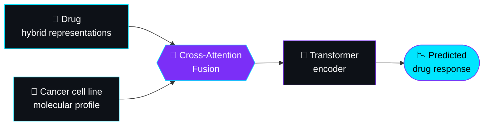

<div align="center">


<br/>

[](https://www.linkedin.com/in/YOUR-LINKEDIN/)
[](mailto:YOUR-EMAIL@example.com)
[](https://github.com/aastha097/neetcode-submissions)

<br/>


</div>

## 🧬 `whoami`

```python
class Aastha:
    def __init__(self):
        self.focus      = ["Deep Learning", "Bioinformatics", "AI Agents", "Full-Stack"]
        self.building   = "DeepCDR-Hybrid: transformers meet cancer drug response"
        self.shipped    = "Dispatch: a live Kanban work-order tracker"
        self.practicing = "DSA on NeetCode, daily"
        self.learning   = "[add what you're learning now]"
        self.superpower = "Turning research ideas into working code"

    def say_hi(self):
        print("Let's build something that matters. 🚀")

Aastha().say_hi()
```

## 🛠️ Toolbox

<div align="center">


</div>

## 🚀 Featured Work

### 📋 Dispatch: Kanban-Style Work Order Tracker &nbsp;`LIVE`

A Trello-style tracker where **organizations → boards → work orders** move through `TODO → IN_PROGRESS → DONE`, with role-based access (admins manage members, members manage work orders).

[](https://trello-six-wine.vercel.app)
[](https://github.com/aastha097/Dispatch-Kanban-workorder-tracker)


- 🔐 JWT authentication with bcrypt-hashed passwords
- 🛡️ Server-enforced admin/member permissions
- 🧱 REST API with 12 routes, plus a React UI styled like a drafting sheet

### 🔬 DeepCDR-Hybrid: how it works



<div align="center">

*"The best way to predict the future is to build it."* 🧪


</div>


